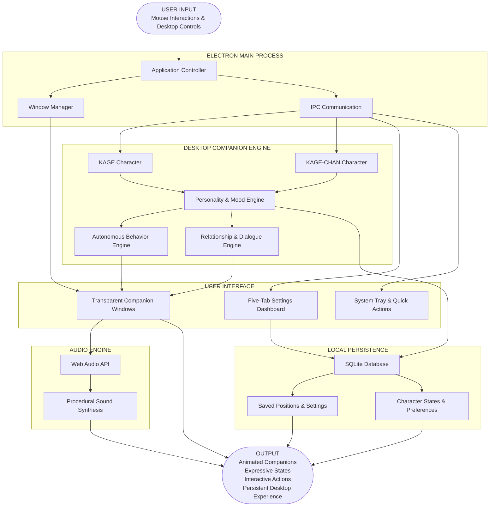

# ◈ KAGE COMPANION — Desktop Companions

[](#)
[](LICENSE)
[](#)
[](#)
[](#)

<p align="center">
  
</p>

<p align="center">
  <strong>KAGE & KAGE-CHAN</strong><br>
  Interactive Desktop Companions for Windows 10 & Windows 11
</p>

<p align="center">
  Black × Blood Red × White | 100% Offline | Zero Configuration Required
</p>

---

## ◆ About the Project

KAGE COMPANION is an independently developed desktop companion application that brings two interactive chibi characters directly onto the Windows desktop.

Built with Electron, JavaScript, and embedded SQLite storage, it provides transparent always-on-top companion windows, expressive character states, autonomous animations, interactive controls, and persistent desktop positioning.

The application features two independent companions:

- **KAGE — The Shadow Pet:** A mischievous shadow creature with glowing blood-red eyes, small horns, and a swishing tail. Curious, playful, lazy, and expressive.
- **KAGE-CHAN — The Chibi Companion:** An anime-inspired companion with long dark hair, crimson highlights, and gothic attire. Caring, supportive, teasing, and slightly tsundere.

Both companions float above ordinary desktop applications, respond to mouse interactions, cycle through expressive poses, and quietly accompany everyday desktop activities.

## ◆ System Architecture



## ❖ Key Features

- **Interactive Desktop Companions**
  - Transparent, frameless companion windows.
  - Always-on-top desktop positioning.
  - Smooth drag-and-drop movement.
  - Independent character visibility controls.
  - Persistent desktop coordinates.
  - Adjustable companion scaling from 60% to 180%.

- **Expressive Character System**
  - 15+ character poses and expressions.
  - Idle, Happy, Sad, Curious, Angry, Sleepy, Surprised, Excited, Walking, Sleeping, Gaming, Coding, Coffee, Music, and Love states.
  - Interactive radial menus with Pet, Play, Sleep, Settings, and Close actions.
  - Autonomous idle animations.
  - Silent companion experience without intrusive notifications or unwanted chatter.

- **Five-Tab Settings Dashboard**
  - **Companions:** Character previews, individual visibility controls, scaling, and position reset.
  - **Behavior:** Animation intervals, responsiveness, and silent desktop mode.
  - **Audio:** Procedural audio controls, master volume, and pitch adjustments.
  - **Startup & Privacy:** Windows startup configuration, local database information, data folder access, and memory reset.
  - **About:** Application version, companion identities, hotkeys, and license information.

- **Procedural Audio Engine**
  - Real-time Web Audio synthesis.
  - Gentle blips, warm purrs, cheerful chimes, and lullabies.
  - Adjustable master volume and pitch.
  - No external audio files required for procedural sounds.

- **Local-First Privacy**
  - Embedded SQLite database.
  - Local application data storage.
  - Designed for fully offline operation.
  - No telemetry or tracking.

- **Windows Startup Integration**
  - Optional automatic Windows startup.
  - Background execution.
  - Restores previously saved companion positions.

## ◆ Mouse & Desktop Controls

| Action | Control | Result |
|---|---|---|
| Move Companion | Click and drag | Repositions the character |
| Cycle Expression | Left-click | Changes character expression |
| Open Companion Menu | Companion interaction | Displays quick actions |
| Open Settings | Right-click companion | Opens settings dashboard |
| Open Settings | Double-click tray icon | Opens settings dashboard |
| Reset Positions | Tray menu → Reset Positions | Restores default positions |

## ⬢ Technologies Used

- Electron 33.2
- JavaScript
- Node.js
- HTML5 & CSS3
- SQLite / SQLite WebAssembly
- Web Audio API
- IPC Communication
- npm

## § Requirements

**For End Users**
- Windows 10 or Windows 11 (64-bit).
- No Node.js, Python, or development tools required for packaged releases.

**For Developers**
- Node.js 18 or higher.
- npm 9 or higher.
- Windows 10 or Windows 11 (64-bit).

## ▲ Installation & Execution

### Option A: Portable Version

1. Download `KAGE-COMPANION-Portable-x64.zip`.
2. Extract the ZIP archive.
3. Open the extracted directory.
4. Double-click `KAGE COMPANION.exe`.
5. Both desktop companions will appear.

### Option B: Windows Installer

1. Download `KAGE-COMPANION-Setup-1.0.0.exe`.
2. Run the installer.
3. Follow the installation instructions.
4. Select **Launch KAGE COMPANION** to start the application.

## ◆ Developer Setup

### 1. Clone Repository

```bash
git clone https://github.com/isbandu/kage-companion.git
cd kage-companion
```

### 2. Install Dependencies

```bash
npm install
```

### 3. Run Development Version

```bash
npm start
```

### 4. Run Automated Tests

```bash
npm test
```

### 5. Build Windows Packages

```bash
npm run dist
```

Build artifacts are generated inside the `dist/` directory:

- `dist/KAGE-COMPANION-Setup-1.0.0.exe` — NSIS Windows Installer.
- `dist/KAGE-COMPANION-Portable-x64.zip` — Portable ZIP Package.

## ◈ Architecture & Project Structure

```text
src/
├── main/
│   ├── database/
│   │   └── db.js
│   ├── engine/
│   │   ├── dialogueDatabase.js
│   │   ├── personalityEngine.js
│   │   ├── relationshipEngine.js
│   │   └── autonomousEngine.js
│   ├── preload/
│   │   ├── companionPreload.js
│   │   └── settingsPreload.js
│   ├── windows/
│   │   ├── companionWindow.js
│   │   ├── settingsWindow.js
│   │   └── welcomeWindow.js
│   └── index.js
└── renderer/
    ├── assets/
    │   └── icons/
    ├── characters/
    │   ├── kage/
    │   └── kage-chan/
    ├── settings/
    ├── welcome/
    └── shared/
        ├── audio/
        └── styles/
```

## ※ Privacy & Data Storage

KAGE COMPANION follows a local-first storage approach.

**Database Location:**

```text
%APPDATA%\kage-companion\kage.sqlite
```

Character settings, saved positions, and other supported application data are stored locally. The application is designed to function without internet connectivity.

## ※ Developer

**Created, Developed & Owned by: ISBANDU RAHUMAN R**


GitHub: [ISBANDURAHUMAN-R](https://github.com/ISBANDURAHUMAN-R)

KAGE COMPANION is an independently developed personal desktop companion application.

## § License

This project is licensed under the [MIT License](LICENSE).

Copyright © Isbandu Rahuman R.
