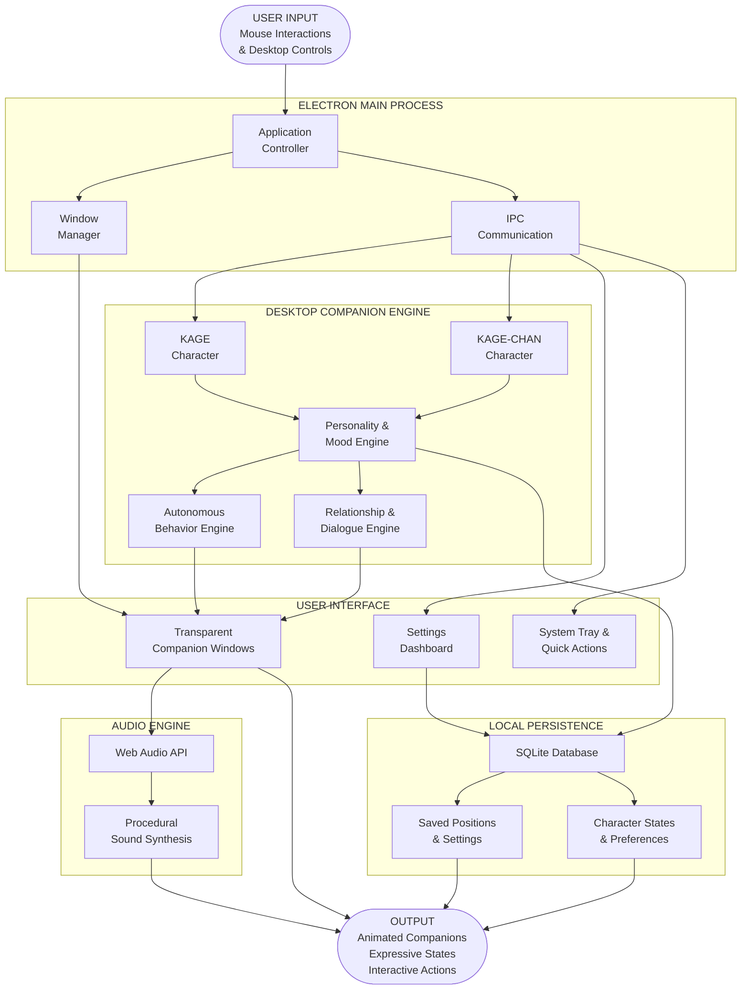

# KAGE COMPANION — Desktop Companions

<p align="center">
  
</p>

<p align="center">
  <strong>KAGE & KAGE-CHAN</strong><br>
  Interactive Desktop Companions for Windows 10 and Windows 11
</p>

<p align="center">
  <a href="#"></a>
  <a href="LICENSE"></a>
  <a href="#"></a>
  <a href="#"></a>
  <a href="#"></a>
</p>

<p align="center">
  <a href="https://github.com/ISBANDURAHUMAN-R/KAGE-COMPANION/releases/download/v1.0.0/KAGE-COMPANION-Setup-1.0.0.exe"></a>
  <a href="https://github.com/ISBANDURAHUMAN-R/KAGE-COMPANION/releases/download/v1.0.0/KAGE-COMPANION-Portable-x64.zip"></a>
  <a href="https://github.com/ISBANDURAHUMAN-R/KAGE-COMPANION/releases/tag/v1.0.0"></a>
</p>


---

## About the Project

KAGE COMPANION is an independently developed desktop application that brings two interactive chibi characters directly onto your Windows desktop.

Built with Electron, JavaScript, and embedded SQLite, the application features transparent companion windows, expressive character states, autonomous animations, interactive controls, and persistent desktop positioning.

### Meet the Companions

- **KAGE — The Shadow Pet:** A mischievous shadow creature with glowing blood-red eyes, small horns, and a swishing tail. Curious, playful, lazy, and expressive.
- **KAGE-CHAN — The Chibi Companion:** An anime-inspired companion with long dark hair, crimson highlights, and gothic attire. Caring, supportive, teasing, and slightly tsundere.

Both companions stay above ordinary desktop applications, respond to mouse interactions, and accompany your everyday desktop activities.

## System Architecture



## Key Features

### Interactive Desktop Companions

- Transparent and frameless companion windows.
- Always-on-top desktop positioning.
- Smooth drag-and-drop movement.
- Independent character visibility controls.
- Persistent companion positions.
- Adjustable scaling from 60% to 180%.

### Character System

- 15+ character poses and expressions.
- Multiple states, including Happy, Sad, Curious, Angry, Sleepy, Surprised, Excited, Walking, Sleeping, Gaming, Coding, Coffee, Music, and Love.
- Interactive radial menus with Pet, Play, Sleep, Settings, and Close actions.
- Autonomous idle animations.
- Silent companion experience without intrusive notifications or unwanted chatter.

### Settings Dashboard

The application includes five settings tabs:

| Tab | Description |
|---|---|
| Companions | Character previews, visibility, scaling, and position reset |
| Behavior | Animation intervals, responsiveness, and silent mode |
| Audio | Master volume, procedural audio, and pitch controls |
| Startup & Privacy | Windows startup, database information, data folder, and memory reset |
| About | Application version, companion information, hotkeys, and license |

### Procedural Audio

- Real-time sound synthesis using the Web Audio API.
- Gentle blips, warm purrs, cheerful chimes, and lullabies.
- Adjustable master volume and pitch.
- Procedural sounds without requiring external audio files.

### Local-First Privacy

- Embedded SQLite database.
- Local application data storage.
- Designed for offline operation.
- No telemetry or tracking.

### Windows Integration

- Optional automatic Windows startup.
- Background execution.
- Restores previously saved companion positions.

## Mouse & Desktop Controls

| Action | Control | Result |
|---|---|---|
| Move Companion | Click and drag | Repositions the character |
| Cycle Expression | Left-click | Changes character expression |
| Open Companion Menu | Companion interaction | Displays quick actions |
| Open Settings | Right-click companion | Opens settings dashboard |
| Open Settings | Double-click tray icon | Opens settings dashboard |
| Reset Positions | Tray menu → Reset Positions | Restores default positions |

## Technologies Used

- Electron 33.2
- JavaScript
- Node.js
- HTML5 and CSS3
- SQLite / SQLite WebAssembly
- Web Audio API
- Electron IPC
- npm

## Requirements

**For End Users**
- Windows 10 or Windows 11 (64-bit).
- No development tools required for packaged releases.

**For Developers**
- Node.js 18 or higher.
- npm 9 or higher.
- Windows 10 or Windows 11 (64-bit).

## Installation & Execution

### Option A: Portable Version

1. Download [**KAGE-COMPANION-Portable-x64.zip**](https://github.com/ISBANDURAHUMAN-R/KAGE-COMPANION/releases/download/v1.0.0/KAGE-COMPANION-Portable-x64.zip).
2. Extract the archive.
3. Open the extracted directory.
4. Run `KAGE COMPANION.exe`.
5. The desktop companions will appear.

### Option B: Windows Installer

1. Download [**KAGE-COMPANION-Setup-1.0.0.exe**](https://github.com/ISBANDURAHUMAN-R/KAGE-COMPANION/releases/download/v1.0.0/KAGE-COMPANION-Setup-1.0.0.exe).
2. Run the installer.
3. Follow the installation instructions.
4. Select **Launch KAGE COMPANION** to start the application.


## Project Structure

```text
src/
├── main/
│   ├── database/
│   │   └── db.js
│   ├── engine/
│   │   ├── dialogueDatabase.js
│   │   ├── personalityEngine.js
│   │   ├── relationshipEngine.js
│   │   └── autonomousEngine.js
│   ├── preload/
│   │   ├── companionPreload.js
│   │   └── settingsPreload.js
│   ├── windows/
│   │   ├── companionWindow.js
│   │   ├── settingsWindow.js
│   │   └── welcomeWindow.js
│   └── index.js
└── renderer/
    ├── assets/
    │   └── icons/
    ├── characters/
    │   ├── kage/
    │   └── kage-chan/
    ├── settings/
    ├── welcome/
    └── shared/
        ├── audio/
        └── styles/
```

## Privacy & Data Storage

KAGE COMPANION uses local storage to maintain supported application data.

**Database Location:**

```text
%APPDATA%\kage-companion\kage.sqlite
```

Character settings, saved positions, and other supported application data are stored locally. The application is designed to function without an internet connection.

## Developer

**Created, Developed & Owned by Isbandu Rahuman R**

GitHub: [ISBANDURAHUMAN-R](https://github.com/ISBANDURAHUMAN-R)

KAGE COMPANION is an independently developed personal desktop companion application.

## License

This project is licensed under the [MIT License](LICENSE).

Copyright © Isbandu Rahuman R.
